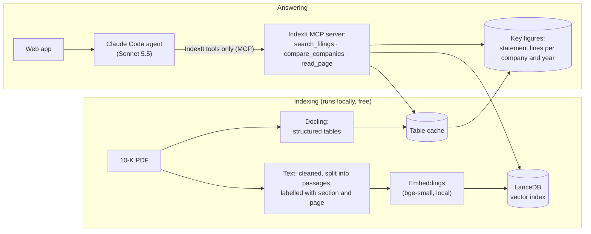

# IndexIt

**The fine print, made simple.** Ask plain-English questions across company annual reports (10-Ks) and get short answers where every fact cites the page it came from.

<!-- Demo GIF: record ~60 s (ask → answer streams in → click a citation → source table → add a filing from the SEC) and save it as docs/demo.gif -->

IndexIt is for people who find annual filings dense and don't know what to look at. Point it at a folder of 10-Ks (or fetch them from the SEC), ask *"Why is Amazon's retail business less profitable than AWS?"*, and it answers in two clearly separated parts: **what the filing says**, with a citation after every fact, and **what this might mean**, labelled as interpretation. It ends with three follow-up questions worth asking next. It never gives buy, sell or hold advice.

## What it does

- **Answers across filings without naming the PDF.** Questions about one company, several companies or several years are routed to the right filings automatically.
- **Cites every fact.** Click a citation to see that page's tables, with their column headers, next to the answer, or open the PDF at that page.
- **Shows its work.** A research trail lists each search Claude made; answers stream in as they're written.
- **Grows with you.** Add filings by uploading PDFs (several at once) or by company and year from the SEC. Each one is checked against its cover page before it joins the library, and is searchable in under a minute.
- **Remembers conversations.** Go back to an earlier conversation and Claude still has its context.
- **Stays in scope.** Off-topic questions get a one-line note on what IndexIt covers, not a guess.
- **Compares companies at a glance.** *Compare* (in the Library) ranks every company on revenue, profit, margins, R&D, growth, cash or debt, with the source page beside each number and a few plain-English observations. A *Side by side* tab puts two companies next to each other on every figure. Each observation has an *Ask IndexIt why* link for the reasons behind it.

## How it works



- **Agentic RAG.** Claude decides what to search for (often several searches per question) through an MCP server that exposes only IndexIt's tools.
- **Company-aware, latest-first search.** A question about Microsoft only searches Microsoft's filings, and most results come from the latest filing unless another year is named.
- **Key figures for comparisons.** Rules read each filing's income statement and balance sheet into one table (revenue, profit, R&D, cash, debt and more), with the page of every number. Questions that rank companies take one lookup instead of one search per company, and ratios are calculated by code, not by the model. Every extracted figure was checked against the SEC's own structured data: 251 of 254 match exactly, none differ.
- **Small-to-big retrieval for tables.** Search finds pages through text passages, and each result page's structured tables are attached, so numbers stay tied to their column headers.
- **Guardrails enforced by configuration, not just the prompt.** The agent has no built-in tools (no files, shell or web), can call only IndexIt's tools, ignores personal Claude settings, sees no other connected apps, and aborts if any other tool appears. Text inside filings is treated as data, never as instructions.

## Decisions, backed by evals

Every decision is logged with its alternatives and trade-offs in [PROJECT.md](PROJECT.md). Quality is judged against an eval set rather than by eye: [59 questions](eval/golden_questions.md) across 10 companies, split into **dev** (used for tuning) and **test** (held out, to catch overfitting). Each answer is checked claim by claim by a separate fact-checking agent, and its flags are reviewed against the filings.

**Choosing the model** (27 dev questions; full write-up in [eval/model_comparison.md](eval/model_comparison.md)):

| Model | Fully correct answers | Answers with a serious error | Median time | Cost per answer (API price) |
|---|---|---|---|---|
| **Claude Sonnet 5.5 (high effort)** | **23 / 27** | **2** | **14 s** | **$0.048** |
| Claude Opus 5.5 (medium effort) | 18 / 27 | 5 | 18 s | $0.123 |
| Claude Opus 5.5 (high effort) | 16 / 27 | 5 | 19 s | $0.134 |

The larger model lost. Opus covered slightly more of each answer key, but it overreached more, adding outside facts and loose summaries ("nearly doubled" for 1.75×). Giving it more effort made that worse. For readers who can't spot mistakes, accuracy matters more than coverage, so IndexIt uses Sonnet.

**After targeted fixes** (prompt rules for the error types found, plus structured tables in search results):

| | Dev, run 1 | Dev, run 2 (with wording rules) | Test (19, held out) |
|---|---|---|---|
| Fully correct answers | 25 / 27 | 24 / 27 | 15 / 19 |
| Wrong facts or numbers | 0 | 1 | 0 |

Between runs, 1–2 different questions fail each time, so differences that small are noise. Most remaining flags are wording that claims more than the cited facts support, such as a "record" year when only five years are shown; the one wrong claim in run 2 put a fiscal year in the wrong calendar year. Reducing these is the next piece of work.

## Run it locally

Requirements: macOS or Linux, Python 3.12 and [uv](https://docs.astral.sh/uv/), and [Claude Code](https://claude.com/claude-code) signed in. Fetching from the SEC also needs Google Chrome, which prints SEC web filings to PDF.

```bash
uv sync
uv run indexit app        # opens http://127.0.0.1:8765
```

Add filings with **+ Add filing** in the app. Other commands:

```bash
uv run indexit filings                          # list the library
uv run indexit search "AMD data center revenue" # see the passages search returns (free, local)
uv run indexit ask-agent "question" --model sonnet --effort high
uv run indexit eval --configs sonnet:high --set dev   # run the eval set (uses your Claude plan)
uv run indexit eval-search                      # search-only eval (free, local)
```

> **Personal use.** IndexIt runs on the Claude Code login of whoever runs it, which suits a single local user. A version for other people would use the Claude API with its own keys.

## Project layout

| Path | What's there |
|---|---|
| `src/indexit/` | Indexing pipelines, search, the MCP server, the agent and its guardrails, the evaluation runner, the filings library, SEC fetch |
| `src/indexit/web/` | The web app: a local server and a single page |
| `eval/` | The eval set, results of every run, and the model comparison |
| `spikes/` | Small experiments behind decisions (parsing, chunking, reranking, table embeddings) |
| [PROJECT.md](PROJECT.md) | Decision log, current state and session history |
| [LEARNING.md](LEARNING.md) | Notes on RAG concepts learned along the way |

## Limitations

- **Text and tables only, by design.** I set out to build multimodal RAG (reading charts as images), but the evidence showed 10-Ks don't need it: the numbers live in tables, which Docling extracts with their headers, and the one recurring chart prints its data as a table right below it. Chart-heavy documents such as investor presentations would need it.
- **About 1 in 10 answers** still overstates a summary claim, even when its cited facts are correct.
- **Designed and tested on US 10-Ks.** Other filing types haven't been evaluated.
- **Not financial advice.**

## About

Built by **Riya Subhedar**, a PM in the AI era, learning and building, project by project, with Claude Code as engineering partner. More projects: [riyasubhedar.github.io](https://riyasubhedar.github.io).

© 2026 Riya Subhedar. All rights reserved. The code is public to read; no license is granted to reuse it.
